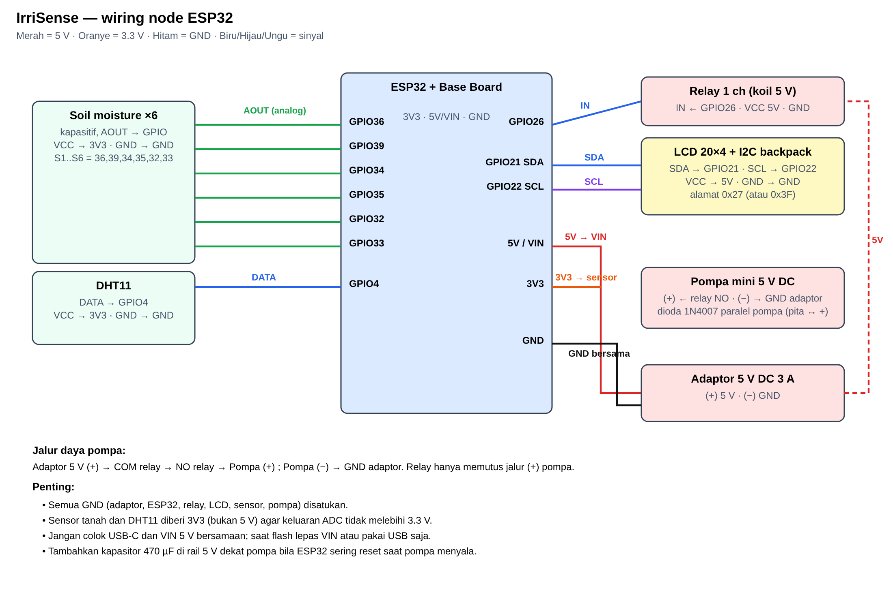

# Wiring node IrriSense (ESP32)



## Tabel pin (sesuai `firmware/src/config.h`)

| Komponen | Pin komponen | Pin ESP32 | Catatan |
|---|---|---|---|
| Sensor tanah 1–6 | AOUT | GPIO 39, 36, 34, 35, 32, 33 | ADC1 saja (ADC2 bentrok dengan Wi-Fi). Semua pin input-only, tanpa pull-up |
| Sensor tanah 1–6 | VCC / GND | 3V3 / GND | Pakai 3V3 agar keluaran ≤ 3.3 V |
| DHT11 | DATA | GPIO 4 | Modul 3 pin sudah ada pull-up; DHT11 4 pin telanjang butuh 10 kΩ ke 3V3 |
| DHT11 | VCC / GND | 3V3 / GND | |
| Relay 1 ch | IN | GPIO 27 | Modul aktif-LOW (`RELAY_ACTIVE_LOW = true`). HIGH 3,3 V tidak cukup mematikannya, jadi firmware membuat pin mengambang untuk OFF |
| Relay 1 ch | VCC / GND | 5 V / GND | Koil 5 V |
| LCD 20×4 I2C | SDA / SCL | GPIO 21 / GPIO 22 | Alamat 0x27, bila kosong ganti 0x3F di `config.h` |
| LCD 20×4 I2C | VCC / GND | 5 V / GND | |
| Adaptor 5 V 3 A | (+) | VIN/5V ESP32, VCC relay, VCC LCD, COM relay | |
| Adaptor 5 V 3 A | (−) | GND bersama | |
| Pompa 5 V | (+) | NO relay | Jalur (+) pompa diputus-sambung relay |
| Pompa 5 V | (−) | GND adaptor | |

## Jalur daya pompa

`Adaptor (+) → COM relay → NO relay → Pompa (+)` dan `Pompa (−) → GND adaptor`.
Pasang dioda 1N4007 paralel dengan pompa (pita/katoda ke sisi +) untuk meredam lonjakan saat relay lepas.

## Catatan keselamatan dan keandalan

- Satukan semua GND (adaptor, ESP32, relay, LCD, sensor, pompa).
- Jangan menyambung USB-C dan VIN 5 V bersamaan. Saat flashing, lepas VIN atau pakai USB saja.
- Anggaran daya: ESP32 ≈ 0.25 A puncak, LCD ≈ 0.1 A, relay ≈ 0.07 A, pompa ≈ 0.6–1 A → < 1.6 A (≤ 10 W, adaptor 3 A cukup). Hanya **satu** pompa yang boleh aktif.
- Bila ESP32 reset saat pompa menyala: tambah kapasitor 470 µF di rail 5 V dekat pompa.
- Backpack I2C LCD pada 5 V biasanya memberi pull-up 5 V ke SDA/SCL. Umumnya tetap berfungsi, tetapi di luar spesifikasi ESP32 (3.3 V). Opsi aman: level shifter I2C, atau lepas pull-up backpack dan pakai pull-up ke 3V3.
- Saat boot, relay tidak boleh berbunyi/klik. Bila klik, balik `RELAY_ACTIVE_LOW` atau pindah GPIO relay.

## Kalibrasi sensor tanah (2 titik)

Lihat langkah 2 di "Urutan uji bangku" di bawah. Syarat: `adcDry > adcWet` dengan selisih ≥ 500. Sensor yang tidak memenuhi dicadangkan.

## Urutan uji bangku

Semua env ini tanpa Wi-Fi/MQTT sehingga **tidak butuh `secrets.h`**. Jalankan dari folder `firmware/`.
Colokkan hanya USB (jangan bersamaan dengan VIN 5 V).

### 1. `bringup` — cek wiring (LEPAS POMPA dulu!)
```
pio run -e bringup -t upload && pio device monitor
```
- Serial mencetak alamat I2C yang ditemukan (`0x27` atau `0x3F`). Bila alamat beda dengan `LCD_ADDR` di `config.h`, ubah lalu upload ulang.
- LCD menampilkan pesan "BRINGUP". Kosong? Putar potensiometer kontras di backpack, atau coba `0x3F`.
- Tiap 3 detik: `RELAY ON`/`RELAY OFF` (relay harus berbunyi klik), `DHT11: suhu=… RH=…` (atau `GAGAL`), dan `ADC mentah: S1..S6`.
- Relay tidak boleh klik saat boot. Bila iya, balik `RELAY_ACTIVE_LOW` di `config.h`.
- Sensor di udara umumnya ADC tinggi (±2500–3500); angka 0 atau 4095 berarti kabel lepas/salah pin.

### 2. `esp32dev_cal` — kalibrasi sensor
```
pio run -e esp32dev_cal -t upload && pio device monitor
```
1. Sensor di udara → ketik `d` + Enter (kering, rata-rata 10 bacaan).
2. Celup sensor ke air sampai garis batas → ketik `w` + Enter (basah).
3. Ketik `p`: tabel per sensor (OK bila selisih ≥ 500 dan dry > wet) dan blok `constexpr SensorCal SOIL_CAL[...] = {...};`.

### 3. Tempel hasil
Ganti `SOIL_CAL` di `firmware/src/config.h` dengan blok dari langkah 2.

### 4. `bench` — uji sistem tanpa jaringan
```
pio run -e bench -t upload && pio device monitor
```
Tiap 5 detik Serial mencetak ADC dan persen tiap sensor, rata-rata, suhu, RH, status pompa. Pompa ON bila rata-rata < 60 %, OFF bila ≥ 80 %. LCD baris 4 menampilkan "BENCH (tanpa WiFi)". Pasang pompa kembali hanya setelah langkah 1–3 beres.
